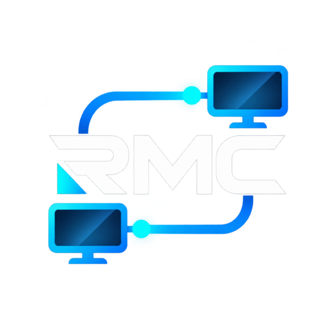
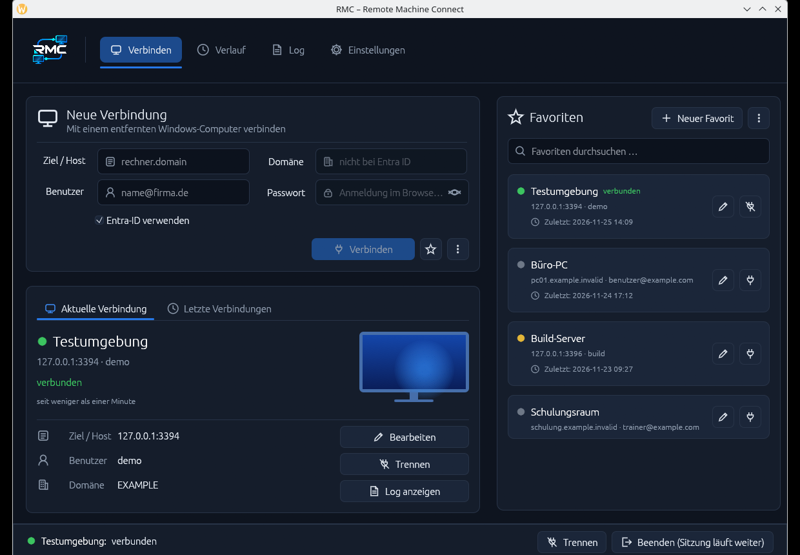
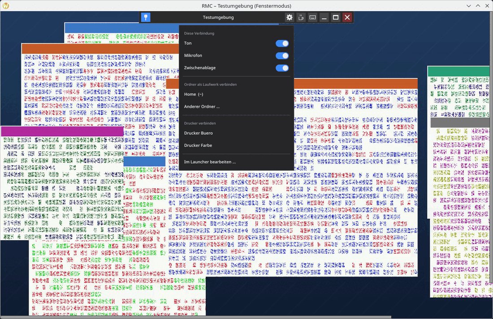

<p align="center">
  
</p>

<h1 align="center">RMC – Remote Machine Connect</h1>

<p align="center">
  Remote-Desktop-Client für Linux (Wayland) mit GPU-Beschleunigung, mehreren Monitoren und Entra-ID-Anmeldung.
</p>

---

RMC verbindet sich per RDP mit Windows-Rechnern, mit lokalen Konten, mit Konten in einer Domäne oder mit Entra-ID-Rechnern samt 2FA. Das Bild wird auf der GPU dekodiert und zusammengesetzt. RMC bleibt dadurch auch bei mehreren hochauflösenden Monitoren flüssig und braucht kaum CPU.



## Funktionen

- **Anmeldung:** Entra ID (RDS AAD) mit 2FA und gespeicherter Anmeldung (Folgestarts ohne Fenster), Benutzer und Passwort (NLA) für Domänen und lokale Konten, Rückfrage bei unbekannten oder geänderten Zertifikaten
- **Grafik:** H.264/AVC444 mit Hardware-Dekodierung auf NVIDIA (NVDEC) oder AMD/Intel (VA-API), sonst auf der CPU, automatisch erkannt. Zusammenbau und Farbumrechnung in Vulkan-Compute-Shadern, Frame-Quittung erst nach der Anzeige
- **Monitore:** Vollbild über beliebig viele Monitore mit frei wählbarem Primärmonitor, Fenstermodus als verschiebbarer 1:1-Ausschnitt oder skaliert
- **Geräte:** Ton, Mikrofon und Webcam, Ordner als Laufwerke, Drucker über CUPS, auch nachträglich während der Sitzung
- **Zwischenablage:** Text, Bilder und Dateien in beide Richtungen, mit Fortschrittsanzeige und Bandbreitengrenze
- **Launcher:** Favoriten mit Suche und Erreichbarkeitsleuchte, mehrere Verbindungen gleichzeitig, Verlauf, aufbereitete Logs, Einstellungen mit Standardwerten und Ausnahmen je Favorit, Tray
- **Verbindungsleiste:** Name der Verbindung, Menü für Ton, Mikrofon, Zwischenablage, Laufwerke und Drucker, „Aktiv halten“ gegen den Abwesenheitsstatus, Tastatur-Grab
- **Datenschutz:** Passwörter und Token nur im Schlüsselbund (KWallet, GNOME Keyring, KeePassXC) oder mit `systemd-creds` verschlüsselt, keine Telemetrie



## Status

RMC ist eine frühe Version und wird täglich mit einem Windows-11-Rechner (Entra ID) auf drei Monitoren eingesetzt.

| | |
|---|---|
| Getestet | Fedora 44, KDE Plasma 6 (Wayland), NVIDIA RTX 50 (NVDEC), AMD Radeon (VA-API, RADV), CPU-Dekodierung |
| Voraussetzung | Grafik mit Vulkan 1.2 (auch Software-Vulkan), Wayland-Compositor mit `ext-data-control` |
| Verteilung | AppImage für x86_64 (Ubuntu 22.04+, Debian 12+, Fedora 36+ und andere) |
| Geplant | kopierfreier VA-API-Pfad (DMA-BUF) |

## Schnellstart

**AppImage:** `RMC-<Version>-x86_64.AppImage` aus den [Releases](https://github.com/Meejch/rmc/releases) laden, ausführbar machen, starten. Der erste Start legt den Startmenü-Eintrag an.

**Aus dem Quellcode:**

```sh
tools/freerdp/build.sh --install   # FreeRDP 3.33.1 mit RMC-Patches nach ~/.local/opt/freerdp-rmc
cargo build --release
tools/install-local.sh             # nach ~/.local/opt/rmc, Startmenü-Eintrag „RMC“
```

Voraussetzungen und Paketlisten stehen in [docs/installation.md](docs/installation.md).

## Dokumentation

| Dokument | Inhalt |
|---|---|
| [Installation](docs/installation.md) | Voraussetzungen, FreeRDP und RMC bauen, installieren |
| [Benutzung](docs/benutzung.md) | Launcher, Anmeldung, Sitzung, Tastenkürzel, Fehlersuche |
| [Konfiguration](docs/konfiguration.md) | Verzeichnisse, Dateien, alle Optionen, Kommandozeile |
| [Sicherheit](docs/sicherheit.md) | Anmeldedaten, Zertifikate, Erreichbarkeitsprüfung, Logs |
| [Architektur](docs/architektur.md) | Aufbau, Prozesse, Grafikpfad, Kanäle |
| [FreeRDP](docs/freerdp.md) | verwendete Version, Patches, Hinweise an FreeRDP |
| [Entwicklung](docs/entwicklung.md) | Repository, Tests, Testschalter, Konventionen |
| [Changelog](CHANGELOG.md) | Änderungen je Version |

## Wie es funktioniert

RMC ist in Rust geschrieben. Das RDP-Protokoll (TLS, Anmeldung, virtuelle Kanäle) übernimmt [FreeRDP](https://github.com/FreeRDP/FreeRDP) über eine dünne C-Schicht. Den Grafikkanal wertet RMC selbst aus:
- FFmpeg dekodiert H.264 mit NVDEC, VA-API oder auf der CPU, je nach vorhandener Hardware.
- Bei NVIDIA gehen die Bilder über CUDA-Vulkan-Interop ohne Umweg über den Hauptspeicher in Compute-Shader.
- Jede Ansicht ist eine eigene Vulkan-Swapchain.

Der Launcher nutzt [egui](https://github.com/emilk/egui). Details in [docs/architektur.md](docs/architektur.md).

## Mitwirken

Fehlerberichte und Vorschläge gern als Issue. Wie man baut und testet, steht in [docs/entwicklung.md](docs/entwicklung.md). Sicherheitslücken bitte nicht öffentlich melden, siehe [SECURITY.md](SECURITY.md).

## Lizenz

RMC steht unter der [Apache License 2.0](LICENSE).

RMC nutzt [FreeRDP](https://github.com/FreeRDP/FreeRDP) (Apache-2.0), [FFmpeg](https://ffmpeg.org/) (LGPL/GPL, je nach Build) und weitere Rust-Bibliotheken (überwiegend MIT/Apache-2.0) mit ihren jeweiligen Lizenzen.
